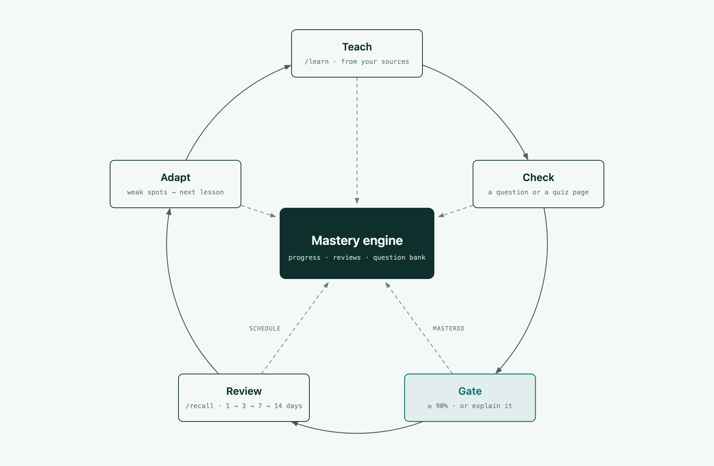
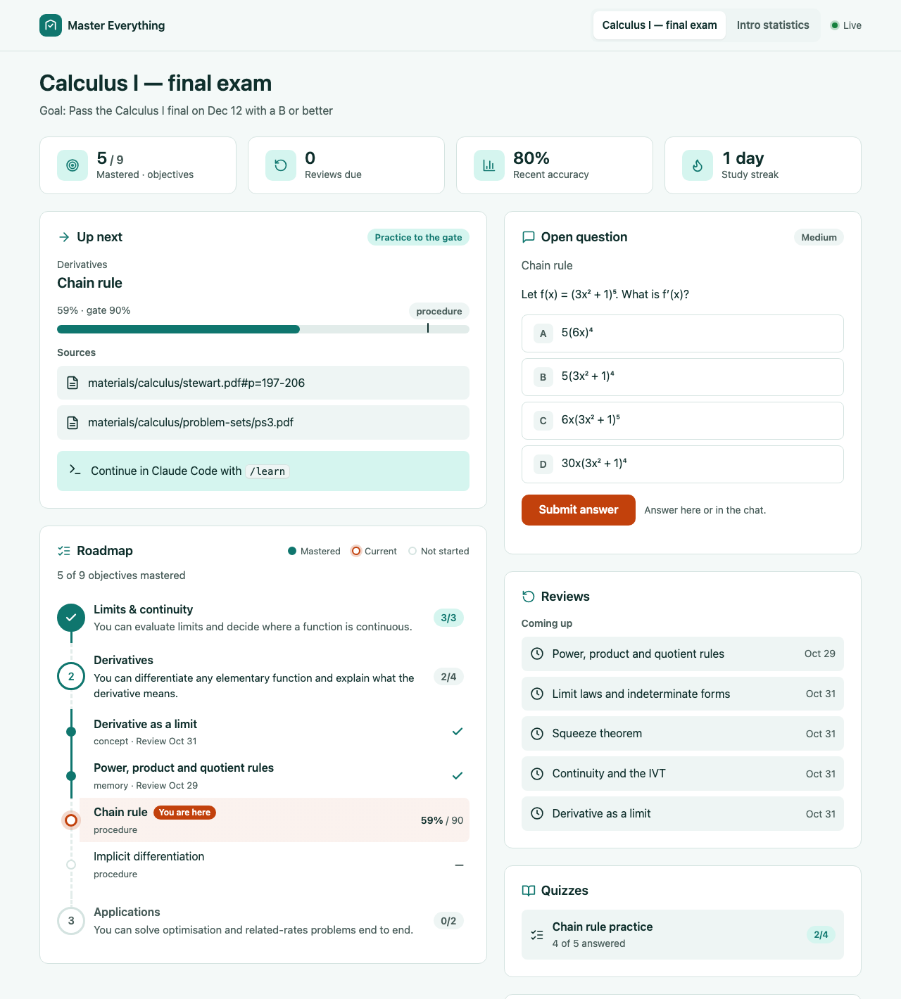
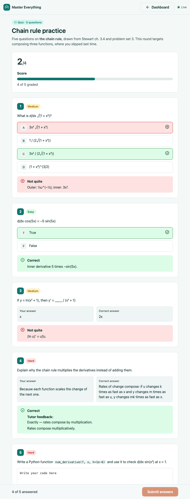
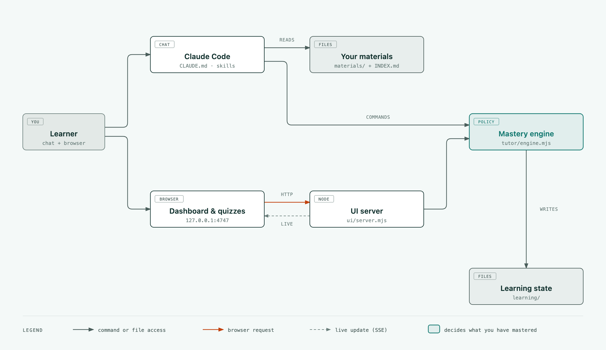

# Master Everything

A tutor for any subject that lives in your Claude Code session. You give it your own material (a textbook, lecture notes, docs, past exams), it builds a study plan with you, teaches from those pages, and only moves you on once you can actually do the thing. The chat is where you learn. A small local web page shows your progress and hosts quizzes.

There is no API key to set up, no server to host and nothing to install beyond Node.js.



## What a session looks like

You open Claude Code in this folder and type `/learn`. The tutor picks up where you left off, at an objective such as *the chain rule*. It explains it using the pages in your textbook and gives you a question, which you answer in the chat or with a click on the dashboard. Get it wrong and it tells you which misconception that answer points to and tries a different example. The next objective unlocks after several correct answers in a row, or, for conceptual topics, once you can explain the idea back in your own words. A few days later the same objective comes back for a short review.

That decision, *has this person learned it?*, is made by a small deterministic engine, not by the model. Facts and procedures need 90% recency-weighted accuracy, and one or two lucky answers cannot reach that. Answers that needed a hint count for half. Reviews follow a fixed ladder (1, 3, 7, 14, 30, 60 days for facts) and reset when you miss one.

## Getting started

You need [Claude Code](https://docs.claude.com/en/docs/claude-code) (any plan, Pro included), Node.js 22 or newer, and git.

The quickest way is to let Claude Code do the setup. Open it in the folder where you want the project and paste:

```text
Set up Master Everything for me from https://github.com/Nguyen1976/master-everything.
Clone it (or reuse my existing checkout), then read CLAUDE.md and guide/AGENT_SETUP.md
and follow that guide: check Node.js, ask me what I want to learn and where my
materials are, bring them into materials/, run the doctor, and tell me how to start
my first lesson. Preserve any existing learning data.
```

Or by hand:

```bash
git clone --depth 1 https://github.com/Nguyen1976/master-everything.git
cd master-everything
cp -R ~/path/to/your/course materials/my-course
npm run doctor
claude
```

Inside Claude Code, run `/ingest` so the tutor catalogues your material, then `/roadmap`. It asks what you already know, what "done" means for you (an exam date, a job interview, a project), how much time you have, and whether you prefer to be tested first or taught first, then proposes a plan you can edit.

## Commands

| Command | What it does |
|---|---|
| `/ingest [path or url]` | Add material and update the catalogue in `materials/INDEX.md` |
| `/roadmap` | Plan, or change the plan; add a roadmap for another subject |
| `/learn` | Continue studying: explanation, question, feedback, until the objective is passed |
| `/recall` | Review what you have already mastered, when it is due |
| `/quiz [topic] [count]` | A practice set built from your material and aimed at your mistakes, opened as a quiz page |
| `/solve [problem]` | A worked solution with a plan and checked steps |
| `/note [topic]` | Save a note to `notes/` |
| `/progress` | Open the dashboard and summarise weak spots |

Plain language works too: "explain that another way", "I think that answer key is wrong", "skip this one", "park this topic for now", "let's review".

## The dashboard and quiz pages

The tutor sends you a link whenever something is easier to look at than to read in a terminal. The dashboard shows the roadmap as a route you travel, where you are on it, the question currently open (you can answer it right there), what is due for review, your quizzes and your recent mistakes with explanations. It updates while you study, so it is worth keeping beside the chat.

Quizzes open as their own page. Multiple choice, true/false and fill-in-the-blank answers are marked as soon as you submit. Written and code answers go to the tutor, and its score and comments appear on the page once you tell it you are done.



<details>
<summary>Quiz page</summary>



</details>

The server only listens on `127.0.0.1`. More in [guide/UI.md](guide/UI.md).

## Your material

Anything Claude Code can read works: PDF, Markdown, plain text, images, notebooks, source code. Word, PowerPoint and EPUB files need to be exported to PDF or Markdown first. Put each course or book in its own folder under `materials/`, or symlink a folder that lives elsewhere. Nothing in `materials/` is committed. Details in [guide/MATERIALS.md](guide/MATERIALS.md).

If you want something to try it with, there is a preset with open JavaScript, Node.js and TypeScript material:

```bash
npm run fetch -- js-node-ts
```

## How it is built



- `CLAUDE.md` holds the tutor's rules: one objective per turn, at most one question, how to explain, how to write good questions.
- `.claude/skills/` has one workflow per command.
- `tutor/engine.mjs` is the policy engine, a single dependency-free file that keeps the mastery gate, scoring, review schedule and question bank.
- `ui/` is the local dashboard and quiz pages.
- Everything personal lives in `learning/`, `notes/`, `practice/` and `materials/`, and all four are git-ignored.

[guide/ARCHITECTURE.md](guide/ARCHITECTURE.md) explains the design and [guide/ENGINE.md](guide/ENGINE.md) documents the engine commands and data.

## Limitations

- Retrieval works from a catalogue with page anchors, not embeddings, so it does best with curated material rather than thousands of loose snippets.
- Large books are read in sections, which makes the first `/ingest` slow for a big library.
- One learner per folder. Clone it again for a second person.
- Terminals don't render LaTeX, so maths in the chat is written in plain notation.

## Contributing

Presets for other subjects, translations of the interface strings, better skills and more tests are all welcome. Start with [CONTRIBUTING.md](CONTRIBUTING.md) and [AGENTS.md](AGENTS.md), then run `npm test` before opening a pull request.

## License

[Apache-2.0](LICENSE). Third-party notices are in [THIRD_PARTY_NOTICES.md](THIRD_PARTY_NOTICES.md). Master Everything is an independent project and is not affiliated with Anthropic.
